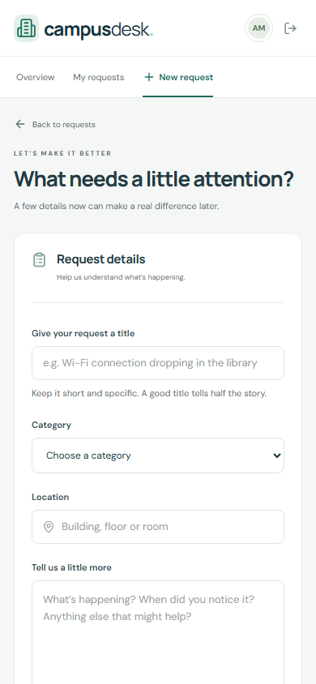

# CampusDesk — client-side screenshot gallery

Actual local captures with fictional demonstration data. Desktop: 1440px; mobile: 390px. Hosted deployment remains pending.

## Sign-in screen with secure student and administrator access.

## Student self-registration; administrators cannot register publicly.

## New account dashboard with a clear empty-state next step.

## Student overview: request counts, recent requests, and category distribution.

## Searchable request list with filters, priorities, statuses, and pagination.

## Simulated API outage demonstrates an explicit error state and retry action.

## New request form with category, location, description, and urgency.

## Request detail showing progress stages, metadata, and activity conversation.

## Administrator overview with campus-wide visibility.

## Administrator resolution controls and a recorded status/comment update.

## 390px mobile dashboard with stacked cards and compact navigation.

## Mobile request list switches from a table to readable request cards.

## Mobile request form with stacked labelled inputs.

