# ICT ACADEMY OF KERALA

## Summer Internship Report

### Full Stack Application Development with ReactJS

# CampusDesk — Campus Service Request Management System

**Submitted by:** Johan Eljo

**Institution:** Sahrdaya College of Engineering and Technology

**Generated:** 26 October 2026

**Status:** Local verification complete; live deployment pending.

## CONTENTS

Summer Internship Report — Full Stack Application Development with ReactJS

| Section | Coverage |

| --- | --- |

| Executive Summary | Purpose, implementation, evidence, and submission status |

| Introduction | Background, problem statement, context, and users |

| Objectives | Functional, learning, and measurable acceptance goals |

| Scope and Deliverables | MVP features, artifacts, and future work |

| Methodology | Development approach, architecture, request flow, and tools |

| Project Activities | Data design, API/security, frontend, and integration |

| Results & Findings | Verification outcomes and desktop/mobile screenshots |

| Conclusion | Outcomes, learning, and remaining deployment work |

| Appendix A | Setup, environment variables, and deployment |

| Appendix B | Recorded API verification scenarios |

| Appendix C | Browser evidence and submission record |

| Appendix D | Official references and project artifacts |

Submitted by Johan Eljo, Sahrdaya College of Engineering and Technology. This report is accompanied by the editable DOCX, Markdown source, screenshots, and machine-readable verification records.

## EXECUTIVE SUMMARY

CampusDesk is an individual full-stack capstone developed by Johan Eljo of Sahrdaya College of Engineering and Technology for the ICT Academy of Kerala internship in Full Stack Application Development with ReactJS. It addresses the difficulty of tracking campus service issues reported through scattered messages and informal channels.

The application provides students with a private workspace to submit service requests, track progress, refine open reports, and add follow-up comments. Administrators use a campus-wide queue to set priorities, update status, and communicate progress. The implementation uses React, Node.js, Express, MongoDB/Mongoose, and a clearly separated client/server architecture.

Key activities included defining user stories and acceptance criteria, preparing the data model and API contract, implementing authentication and ownership checks, designing responsive client views, integrating the API, testing database persistence and authorization, and producing deployment and submission documentation.

Local verification completed successfully: 16 API integration scenarios and 15 browser scenarios passed. Thirteen major client-side screens were captured, including mobile layouts. Automated accessibility scans reported no violations on the captured screens for the selected WCAG A/AA rules. These scans do not constitute complete accessibility certification.

### Submission snapshot

| Item | Recorded status |

| --- | --- |

| Project | CampusDesk — Campus Service Request Management System |

| Student | Johan Eljo |

| Institution | Sahrdaya College of Engineering and Technology |

| GitHub repository | https://github.com/johanisdone/assignment4 |

| Hosted project | Pending production Atlas configuration and authenticated hosting deployment. |

| Live verification | Pending; local checks do not establish hosted operation. |

| Report generated | 26 October 2026 |

The current deliverable is a locally verified application and evidence-backed report. The hosted project link and live Atlas/HTTPS acceptance results must be added after deployment before the final submission is considered complete.

## INTRODUCTION

### Background and context

Students regularly encounter infrastructure, network, library, academic-service, and hostel issues. When each report exists only as a message or a conversation, it is difficult for the reporting student to know what happened next and difficult for the service team to maintain a consistent queue. CampusDesk explores a single, traceable workflow for these requests.

### Problem statement

Campus service reports lack consistent tracking and visible progress when they are spread across informal channels. Students and service administrators need a shared record of the issue, its current status, and the updates leading to resolution.

### Existing approaches and project rationale

Email, spreadsheets, and group messaging can record issues but require manual coordination and repeated follow-ups. A service-request web application adds structured fields, ownership, a queue, and a persistent activity trail. This comparison is a design rationale, not the result of a formal survey or a measured study at the institution.

### Technical foundation

The MERN architecture separates responsibilities: React manages browser interaction [1], Express and Node.js handle HTTP requests and business rules [2, 3], and MongoDB stores structured documents accessed through Mongoose [4, 5]. The React application talks to the API and never directly to MongoDB.

### Intended users

- Student: registers and signs in, submits and tracks personal requests, edits or deletes own open reports, and adds comments.

- Administrator: accesses the campus-wide queue, reviews request details, sets priority, changes status, and posts progress updates.

- Evaluator: reviews the public source code, documented setup, report, screenshots, and eventual hosted application.

## OBJECTIVES

The project objectives are expressed as functional outcomes and verifiable engineering goals.

- Create a responsive React interface with clear navigation for sign-in, registration, overview, request list, request creation, and request detail.

- Implement server-side authentication using bcrypt password hashing and expiring JWT-backed HttpOnly cookies.

- Enforce authorization so a student cannot access another student’s requests and cannot become an administrator through public registration.

- Implement request creation, retrieval, update, and deletion with server-side validation and appropriate HTTP status codes.

- Provide administrator status and priority controls with a persistent activity record.

- Connect the client through one API service, using an environment-based API URL and protected routes.

- Support search, combined filters, and bounded pagination for growing request lists.

- Handle loading, success, empty, and error states, including a visible retry path.

- Verify core workflows through real API/database tests and browser journeys, and record evidence honestly.

- Prepare reproducible setup, deployment configuration, screenshots, and internship-report documentation.

### Learning objectives

The implementation exercises component design, controlled forms, routing, context-based shared state, REST API design, Mongoose schema constraints, ownership-based access control, asynchronous error handling, responsive CSS, Git version control, browser automation, and technical reporting.

### Measurable acceptance targets

| Target | Evaluation approach |

| --- | --- |

| 390px and 1440px layouts | Browser captures and horizontal-overflow checks |

| Private student data | Cross-user access tests for every protected operation |

| Bounded results | Default 8 records; maximum 50 per page |

| No secrets in client or response | Environment separation and password-hash response assertions |

| Core flows persist | MongoDB assertions plus complete browser CRUD journey |

## SCOPE AND DELIVERABLES

### Included in the MVP

- Student registration, login, current-session lookup, and logout.

- Role-aware dashboards with scoped totals, recent requests, and category distribution.

- Request fields: title, category, location, description, priority, status, owner, reference, timestamps, and embedded activity.

- Student-owned request CRUD, with edit/delete restricted to Open status.

- Administrator resolution controls and shared request comments.

- Search across title/reference/location, status and category filtering, and pagination.

- Responsive desktop/mobile screens, labelled fields, keyboard focus styles, safe errors, and retry controls.

### Deliverables produced

| Deliverable | Repository location |

| --- | --- |

| React client | client/src/ |

| Express/MongoDB API | server/src/ |

| API integration tests | server/test/api.test.js |

| Browser verification | scripts/browser-check.mjs |

| Evidence records | docs/evidence/ |

| Major-view screenshots | docs/screenshots/ |

| Report PDF, DOCX, Markdown | docs/report/ |

| Deployment blueprint and guide | render.yaml; docs/DEPLOYMENT.md |

| Project definition and contract | docs/PROJECT_BRIEF.md |

### Deferred features

Attachments, email notifications, staff assignment, password reset, email verification, institutional single sign-on, and multi-campus support are outside the MVP. The application is a capstone prototype rather than an institutionally approved operational system. Production availability, backups, and long-term support require deployment decisions.

### Individual contribution

This is an individual submission by Johan Eljo, covering the application design, implementation, integration, verification, and documentation described in this report.

## METHODOLOGY

### Incremental development approach

The work was organized around a bounded MVP. User stories, acceptance criteria, wireframes, a data model, and an API contract were documented first. The backend and frontend were then built in separate folders and integrated through the shared HTTP contract. Local checks were run against isolated databases to avoid touching production data.

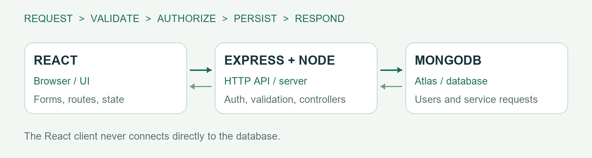

### Request flow: submitting a service issue

- React validates the controlled form and sends JSON to POST /api/requests.

- Express parses the body, checks the origin and session, validates fields, and calls the controller.

- The controller uses the authenticated user as owner; ownership is never accepted from client input.

- Mongoose validates and saves the request in MongoDB with its first activity event.

- The API returns 201 and the created resource. React navigates to the persisted detail page or shows an error while retaining the form values.

### Tools and design decisions

Vite provides the client build pipeline, React Router provides route-level navigation, and Context manages authentication and notifications. The Express server uses central validation and error middleware, Mongoose models, thin routes, and controller functions. A same-origin production layout simplifies cookie handling and avoids unnecessary cross-domain configuration.

Git commits capture definition, backend, frontend, verification, and documentation milestones. Node’s test runner with Supertest and a temporary MongoDB process validates the API. Playwright exercises the built client in Chromium, and axe checks selected accessibility rules. ReportLab and python-docx generate this report from one evidence-backed source.

## PROJECT ACTIVITIES — DESIGN AND DATA

### Planning and wireframes

The desktop layout uses a persistent sidebar, breadcrumb header, summary cards, request table, and category panel. At narrow widths, navigation becomes horizontal, metrics use two columns, request rows become cards, and forms stack vertically. Authentication screens have a campus-oriented introduction beside a compact form.

### Data modelling

| Entity | Important fields / constraints |

| --- | --- |

| User | name; unique lowercase email; passwordHash excluded by default; student/admin role; timestamps |

| ServiceRequest | unique CD reference; title 5–120; description 15–3000; location 3–120; category enum; priority enum; status enum; owner reference; activity; timestamps |

| Embedded activity | actor display-name snapshot; created/updated/status/comment type; message; event time; maximum 200 events |

Users are referenced because they are shared across multiple requests. Activity events are embedded because they belong to one request and are displayed with it. Activity size is deliberately bounded; archiving would be needed for exceptionally long conversations. The database indexes unique email/reference, owner plus creation time, and status plus creation time.

### Authorization and workflow rules

- Public registration creates only students and rejects unexpected fields.

- Student list, detail, statistics, edit, comment, and delete queries are scoped by the authenticated owner.

- Administrator status routes require server-side administrator authorization.

- Administrators cannot rewrite or delete another student’s original report.

- Students can edit/delete only Open requests. Updates and comments append actor/date events.

- Optimistic concurrency detects conflicting saves; deletion checks ownership, status, and document version.

### Status lifecycle

The main displayed progression is Open → In progress → Resolved → Closed. Administrators may deliberately move between the supported statuses, including reopening an issue. Every status/priority change is recorded. Closed is a distinct status and is not silently counted as Resolved in the dashboard card.

## PROJECT ACTIVITIES — API AND SECURITY

### API overview

| Method and endpoint | Purpose / authorization |

| --- | --- |

| POST /api/auth/register | Create student; name, email, password; 201 |

| POST /api/auth/login | Sign in; email/password; 200 + session cookie |

| POST /api/auth/logout | Clear browser session cookie; 200 |

| GET /api/auth/me | Current signed-in user; 200/401 |

| GET /api/requests | Scoped list with page, limit, search, status, category |

| GET /api/requests/stats | Scoped totals and category distribution |

| POST /api/requests | Create own request; 201 |

| GET /api/requests/:id | Owner or admin reads request |

| PATCH /api/requests/:id | Owner edits complete content; Open only |

| PATCH /api/requests/:id/status | Admin changes status and priority |

| POST /api/requests/:id/comments | Owner/admin adds an activity comment; 201 |

| DELETE /api/requests/:id | Owner deletes Open request; 200 |

| GET /api/health | Database readiness; 200 or 503 |

Success resources use {data: ...}; list results include pagination. Errors use {message, errors?}. Validation failures return 400, missing sessions 401, forbidden actions 403, unavailable records 404, conflicts 409, and rate-limit responses 429. Unexpected failures return a safe 500 message.

### Security implementation

Passwords are hashed with bcrypt at cost 12. JWTs expire after eight hours and are issued in HttpOnly, SameSite=Lax cookies; production adds Secure. Role information is loaded from the database rather than trusted from browser state. Server input schemas reject unexpected fields and query operators. Search input is escaped before regex construction. Mutating browser requests enforce the configured origin, and CORS allows only the configured UI origin.

Helmet supplies security headers, authentication routes have stricter rate limits, JSON request size is bounded, and API responses use no-store caching. Secrets remain in server environment variables. Administrator bootstrap is server-side and requires a private password; those settings should be removed after initial provisioning. No real credentials appear in this report.

## PROJECT ACTIVITIES — INTERFACE AND INTEGRATION

### Client-side implementation

Route-level pages cover login, registration, overview, request listing, request creation/editing, and request detail. Reusable components provide the shell, brand, table/cards, field wrappers, status badges, loading/error/empty views, and page headings. A centralized API module supplies the base URL, credentials, JSON parsing, and consistent errors.

Forms use controlled fields, client-side checks, visible labels, character limits, disabled save buttons during requests, and inline validation feedback. Server validation remains authoritative. Shared authentication state is held in Context; an expired protected request clears client session state and redirects to sign-in.

### Four-state screens

| State | Implemented response |

| --- | --- |

| Loading | Labelled spinner while requests or session are being loaded |

| Success | Scoped counts, request results, metadata, and activity |

| Empty | Helpful next step for new accounts; separate no-match filter message |

| Error | Safe user-facing message and retry; forms retain entered values |

### Challenges and fixes

- Early light secondary text failed automated colour-contrast checks. The text and badge palettes were darkened and scans rerun on every captured screen.

- Dependency audit detected advisories in an earlier router release. The router was upgraded to a patched release and the production build and browser journeys rerun.

- A sign-out toast could persist into a subsequent sign-in. The unnecessary toast was removed to keep the session transition clear.

- Local production-bundle testing and actual hosted verification were treated separately, so the report does not present local screenshots as proof of deployment.

### Version control evidence

The repository contains meaningful milestone commits for the brief, backend, frontend, verification, and documentation. The implementation was developed individually. A repository history supports source review, but does not by itself establish that live hosting or institutional rollout has occurred.

## RESULTS & FINDINGS

### Observed local verification results

| Evidence | Result | Scope |

| --- | --- | --- |

| API integration | 16 passed | Express + isolated MongoDB 8.2.6 |

| Browser journeys | 15 passed | Chromium; built React client + API + database |

| Screenshots | 13 | 1440px desktop; 390px mobile |

| Accessibility scans | 13 screens scanned | Selected axe WCAG A/AA checks; no reported violations |

| Uncaught browser errors | 0 | Observed during scripted browser journey |

| Hosted / Atlas flow | Pending | Not established by local temporary-database tests |

API evidence timestamp: 2026-10-26T17:10:37.126Z. Browser evidence timestamp: 2026-10-26T17:27:22.383Z. The browser run completed in approximately 47 seconds on the development machine; this is test-suite duration, not an application response-time benchmark.

### Functional findings

- Created, edited, commented, and deleted requests persisted as expected in the isolated database.

- Student data isolation applied consistently to listing, statistics, reading, editing, commenting, and deletion.

- Only administrators could modify resolution status; student views reflected those changes after navigation/reload.

- Filters and pagination returned the expected synthetic result sets, including empty matches.

- A deliberately simulated local API outage produced an error view, and retry restored genuine database results.

- Refreshing a protected request deep link served the built client and retrieved the persisted record.

### Interpretation and limits

These observations support functional correctness of the tested MVP paths. They do not quantify reduced resolution times, user satisfaction, performance under campus-scale traffic, or production reliability. The synthetic screenshots illustrate software behaviour and must not be interpreted as real campus service records.

The following pages contain actual client-side screenshots. The hosted URL remains pending production deployment.

## RESULTS — SIGN-IN VIEW

The sign-in page provides labelled email/password fields and a registration link. Passwords are not displayed in the screenshot.

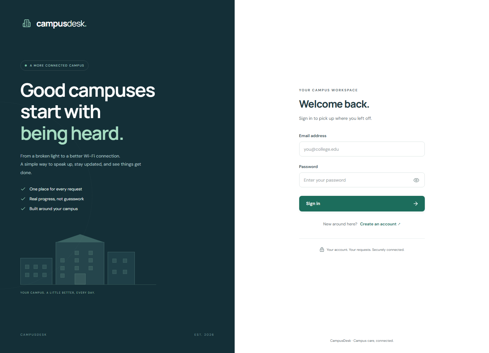

Capture environment: local production React bundle served by Express, backed by an isolated temporary MongoDB instance. Fictional demonstration users and requests only.

## RESULTS — STUDENT REGISTRATION

Self-registration creates a student account. Administrator provisioning is intentionally handled privately on the server.

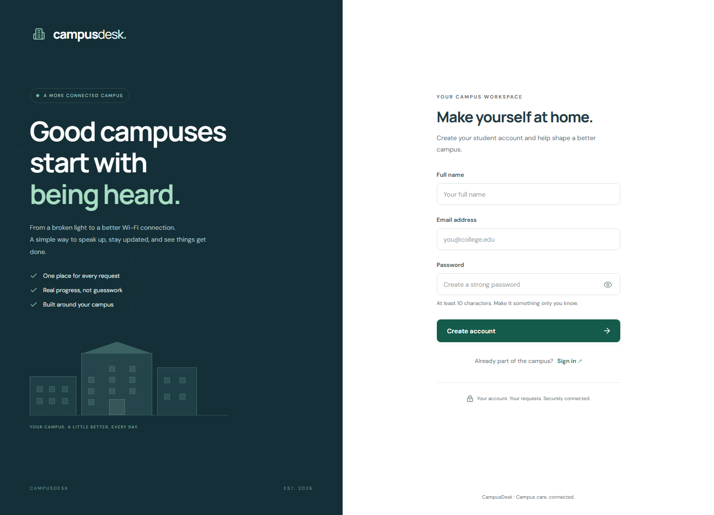

Capture environment: local production React bundle served by Express, backed by an isolated temporary MongoDB instance. Fictional demonstration users and requests only.

## RESULTS — STUDENT OVERVIEW

The overview combines scoped request totals, recent items, and category distribution. All records shown are synthetic.

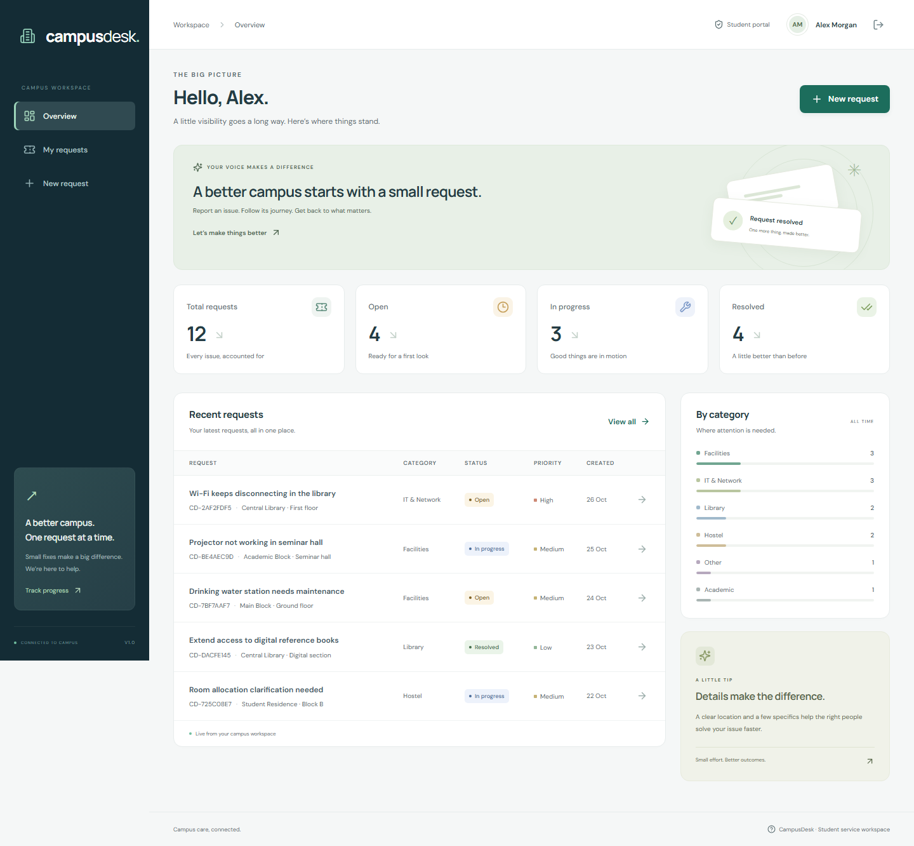

Capture environment: local production React bundle served by Express, backed by an isolated temporary MongoDB instance. Fictional demonstration users and requests only.

## RESULTS — REQUEST LIST

The list supports search, status/category filters, and pagination. Each row links to the detailed request record.

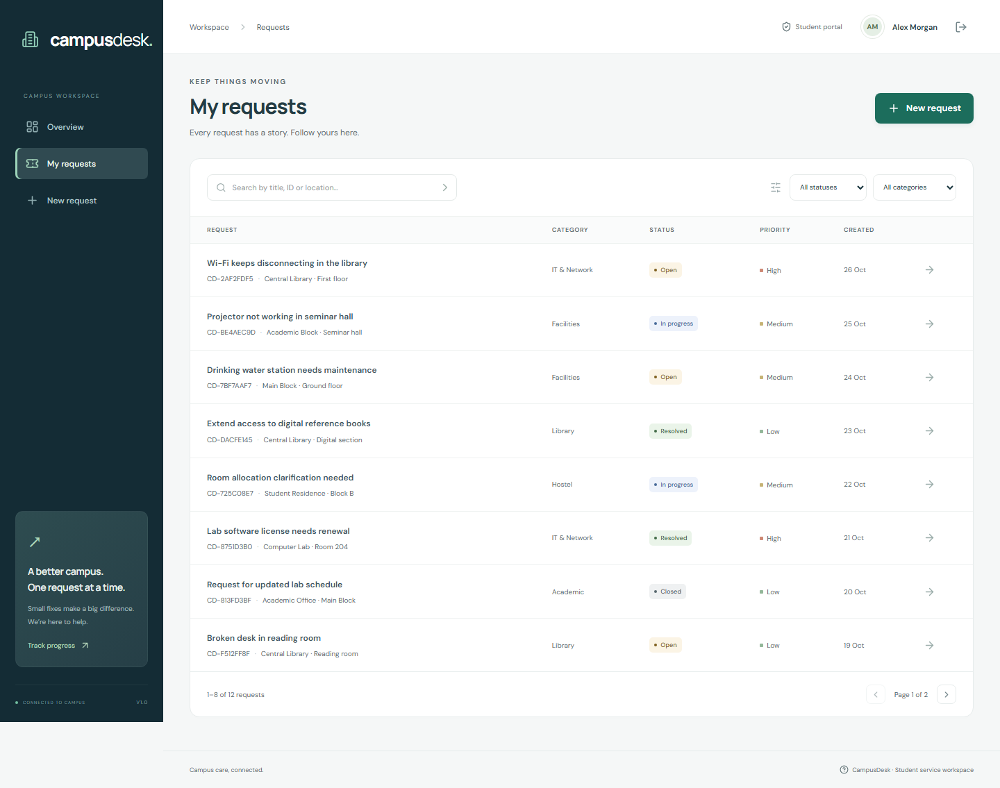

Capture environment: local production React bundle served by Express, backed by an isolated temporary MongoDB instance. Fictional demonstration users and requests only.

## RESULTS — NEW REQUEST FORM

Students provide a clear title, category, location, description, and urgency. Validation is implemented on both client and server.

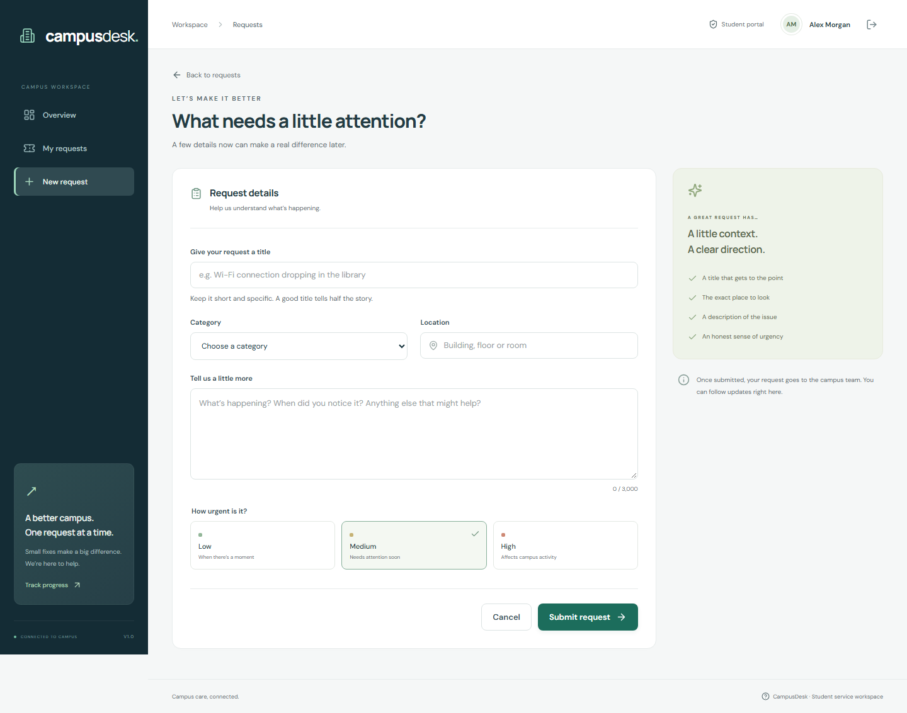

Capture environment: local production React bundle served by Express, backed by an isolated temporary MongoDB instance. Fictional demonstration users and requests only.

## RESULTS — REQUEST DETAIL

The detail view brings together the original description, lifecycle indicator, metadata, and activity conversation.

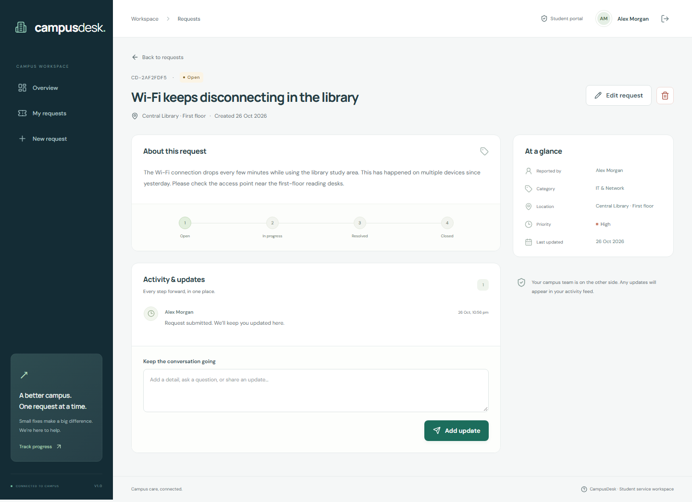

Capture environment: local production React bundle served by Express, backed by an isolated temporary MongoDB instance. Fictional demonstration users and requests only.

## RESULTS — ADMINISTRATOR OVERVIEW

The administrator sees campus-wide data in the same visual workspace, with a role-aware work queue.

Capture environment: local production React bundle served by Express, backed by an isolated temporary MongoDB instance. Fictional demonstration users and requests only.

## RESULTS — RESOLUTION DESK

An administrator updates status/priority and adds a follow-up. Both changes are persisted and visible to the reporting student.

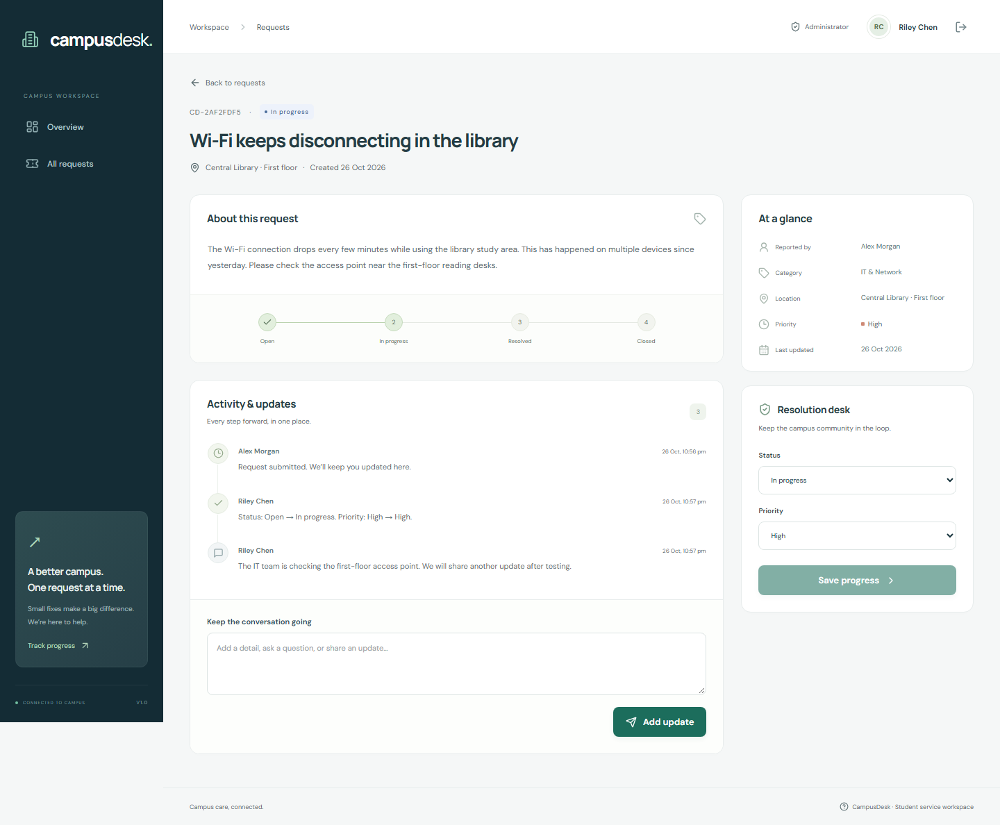

Capture environment: local production React bundle served by Express, backed by an isolated temporary MongoDB instance. Fictional demonstration users and requests only.

## RESULTS — MOBILE CLIENT VIEWS

The application adapts to a 390px viewport. The sidebar becomes a compact navigation row, metrics form two columns, and request tables become touch-friendly cards. The captured viewports were checked for page-level horizontal overflow.

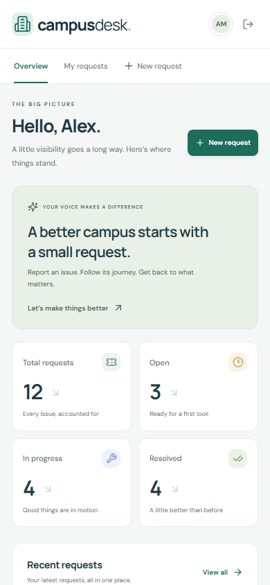

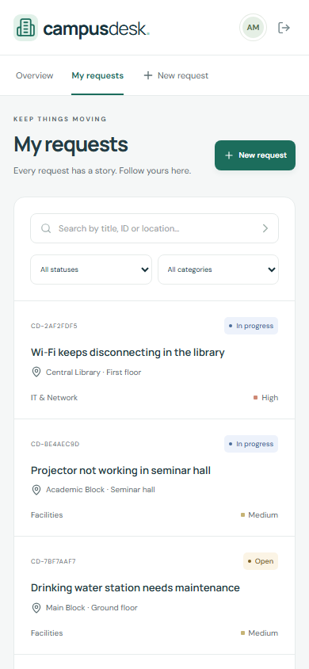

Figures 10–11. Mobile overview and request list, captured at 390 × 844 pixels. These are real local screenshots, not wireframe mockups.

The complete mobile form capture is also included as docs/screenshots/13-mobile-form.png. Automated checks are supplemented by labelled fields, focus states, semantic navigation, and reduced-motion CSS; screen-reader and wider browser coverage remain future verification work.

## RESULTS — EMPTY AND ERROR STATES

Empty and error states are first-class parts of the interface. A newly registered account receives a clear invitation to submit its first request. A failed list fetch shows a safe message and an explicit retry action.

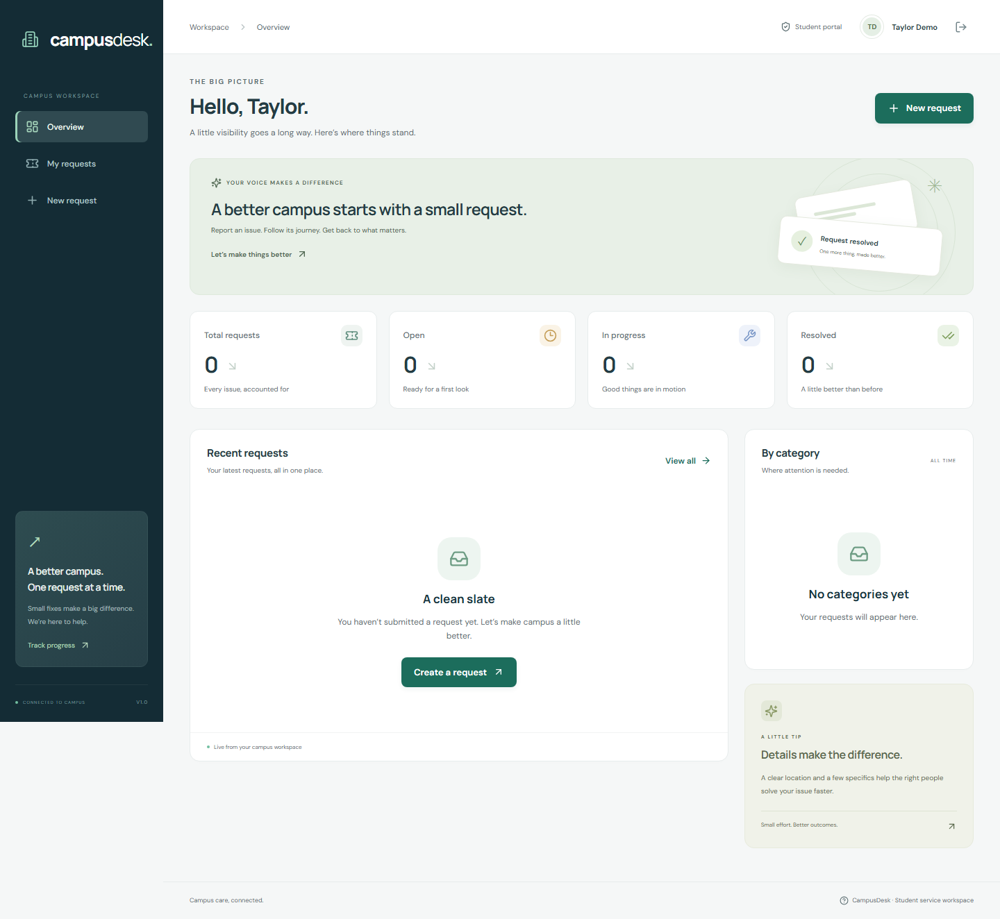

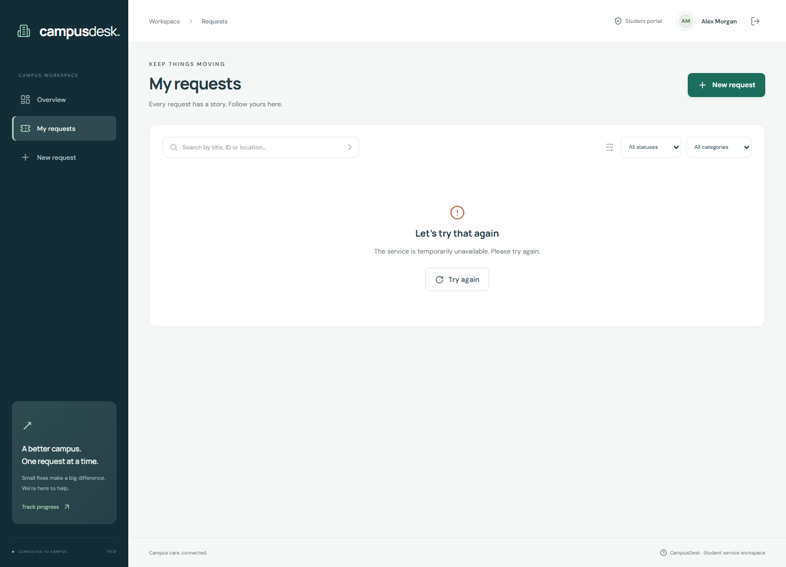

The error response was intercepted only inside the local browser test. No real hosted outage or production incident is claimed.

## CONCLUSION

CampusDesk demonstrates an end-to-end MERN service-request workflow with distinct student and administrator responsibilities. The completed local implementation covers authentication, ownership-protected CRUD, resolution updates, activity comments, scoped dashboards, filters, pagination, and responsive client-side views.

The project met its locally testable functional objectives: requests persist, students cannot access another user’s data, administrators control status updates, and the client handles normal and failure paths clearly. The evidence consists of automated API/database tests, real browser interactions, accessibility scans, and actual screenshots.

### Learning and reflection

The project illustrates why backend authorization must remain authoritative, why consistent API contracts simplify integration, and why empty/error states need as much attention as success screens. Accessibility testing exposed issues that were not obvious from visual inspection. Versioned source, repeatable verification, and evidence-based documentation make the result easier for another developer or evaluator to inspect.

### Remaining work before final submission

- Provision production MongoDB Atlas access and an authenticated hosting deployment.

- Run the live HTTPS, session, ownership, deep-link, and CRUD acceptance checks.

- Add the real hosted URL to docs/submission.json and regenerate the report.

- Keep the repository publicly accessible for evaluator review; public visibility has been confirmed.

### Future improvements

The next iteration could introduce email verification/password reset, attachments with controlled storage, staff assignment, notification delivery, query/index tuning, an external rate-limit store, and a documented archival policy for long activity histories. Broader device, assistive-technology, load, and recovery testing would be appropriate before real institutional use.

## APPENDIX A — SETUP AND DEPLOYMENT

### Repository and hosted links

GitHub: https://github.com/johanisdone/assignment4

Hosted application: Pending production Atlas configuration and authenticated hosting deployment.

### Local setup

- Install Node.js 22+ and run npm install at the repository root.

- Copy server/.env.example to server/.env and configure MONGODB_URI, JWT_SECRET, and CLIENT_ORIGIN.

- Optionally configure a private initial administrator account. Do not commit the real .env.

- Run npm run dev and open http://localhost:5173.

- For production-bundle testing: npm run build followed by npm start.

### Environment variables

| Variable | Purpose |

| --- | --- |

| MONGODB_URI | Private Atlas/local database connection string |

| JWT_SECRET | Private session-signing secret, at least 32 characters |

| CLIENT_ORIGIN | Exact allowed browser origin; HTTPS in production |

| PORT / NODE_ENV | Server listener and environment mode |

| ADMIN_NAME / EMAIL / PASSWORD | Optional initial server-side administrator provisioning |

| TRUST_PROXY | Explicit reverse-proxy hops; verify for chosen host |

| VITE_API_URL | Public client API base; default /api, never a secret |

### Hosting configuration

render.yaml describes a Node web service that builds the React client and serves it with the API. The build command is npm ci --include=dev && npm run build and the start command is npm start. The health endpoint is /api/health. Production requires valid Atlas credentials, a host-compatible network allowlist, HTTPS, and the exact deployed origin. See docs/DEPLOYMENT.md for the complete post-deployment checklist.

Record the deployed URL and live acceptance results in docs/submission.json, then regenerate this report.

## APPENDIX B — VERIFICATION EVIDENCE

### API scenarios recorded as passed

- Registration creates student, hashes password, and issues HttpOnly SameSite cookie

- Registration rejects invalid input, duplicate email, and public admin escalation

- Login rejects bad credentials and logout invalidates browser session

- Protected endpoints reject missing and malformed sessions

- Create, read, edit, comment, and delete persist through MongoDB

- Student ownership is enforced for lists, details, edits, comments, deletes, and stats

- Only administrators can update resolution; changes appear in activity history

- Non-open requests cannot be edited or deleted; admin cannot rewrite original report

- Search, combined filters, and pagination return bounded consistent results

- Validation rejects malformed IDs, query operators, invalid enums, and oversized pages

- Missing resources return 404 and empty comments return 400

- Origin protection blocks cross-site mutations but accepts the configured UI origin

- Errors are safe JSON, health checks database readiness, and responses are not cached

- Sensitive authentication endpoints are rate limited

- Production cookies are Secure and the frontend receives security headers

- Activity growth is bounded with a recoverable conflict response

Machine-readable source: docs/evidence/api-results.json. Tests are implemented in server/test/api.test.js. Test account passwords and signing secrets are generated at runtime and are not stored as public credentials.

## APPENDIX C — BROWSER EVIDENCE AND REVIEW

### Browser scenarios recorded as passed

- Sign-in inline validation rejects empty input.

- Student registration creates a signed-in account with an empty scoped dashboard.

- Sign-in loads persisted student requests and counts.

- Pagination loads the next and previous result pages.

- Status filtering and no-match search produce correct result/empty states.

- A simulated API outage shows retry; retry restores real database results.

- Create validates inputs, saves to MongoDB, and opens the new request.

- Comment and edit update the request and preserve activity history.

- Confirmed deletion removes an open request from MongoDB.

- Refreshing a deep link returns the application and persisted request.

- Administrator changes status and posts an update through the browser.

- Student sees administrator updates and cannot edit a non-open request.

- Dashboard, list, and form work at 390px without horizontal overflow.

- No uncaught JavaScript errors during the complete browser journey.

- Major desktop/mobile screens pass automated serious/critical WCAG A/AA checks.

### Review boundaries

Source: docs/evidence/browser-results.json. Chromium is the tested browser. Tests use synthetic data and an isolated database, with captured screens at 1440px and 390px. Automated accessibility findings cover the selected rules only. Production Atlas connectivity, live HTTPS operations, disaster recovery, and performance under load remain unverified.

### Submission checklist

| Item | Status |

| --- | --- |

| Source code, README, environment examples | Prepared |

| API/browser verification and screenshots | Completed locally |

| PDF/DOCX/Markdown report | Generated from observed evidence |

| Public GitHub access | Public visibility confirmed via unauthenticated GitHub API |

| Hosted project URL and live flows | Pending |

| Final report with verified hosted link | Regenerate after deployment |

## APPENDIX D — REFERENCES

The supplied ICTAK MERN Stack Project Guidelines and Reference Guide and the Summer Internship Report template informed the project organization and report structure. The official references below support the technology choices and implementation.

- [1] React documentation — https://react.dev/

- [2] Express documentation — https://expressjs.com/

- [3] Node.js documentation — https://nodejs.org/en/docs

- [4] MongoDB Atlas documentation — https://www.mongodb.com/docs/atlas/

- [5] Mongoose documentation — https://mongoosejs.com/docs/

- [6] Git documentation — https://git-scm.com/doc

- [7] GitHub documentation — https://docs.github.com/

- [8] Express security best practices — https://expressjs.com/en/advanced/best-practice-security.html

- [9] MDN HTTP reference — https://developer.mozilla.org/en-US/docs/Web/HTTP

- [10] WCAG quick reference — https://www.w3.org/WAI/WCAG22/quickref/

- [11] Playwright documentation — https://playwright.dev/docs/intro

- [12] Render Node/Express deployment — https://render.com/docs/deploy-node-express-app

### Project artifacts

The repository README links the definition, deployment guide, testing record, screenshot gallery, and report. The Python generator regenerates the editable and PDF versions from the same text and evidence, reducing inconsistent counts or captions between formats.

Prepared for Johan Eljo, Sahrdaya College of Engineering and Technology. Report structure follows the supplied ICTAK internship template.
